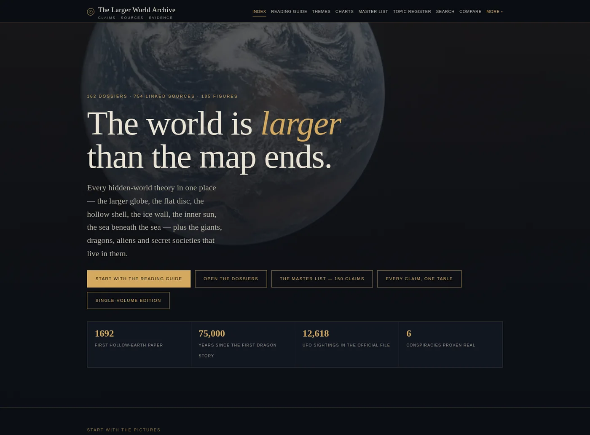
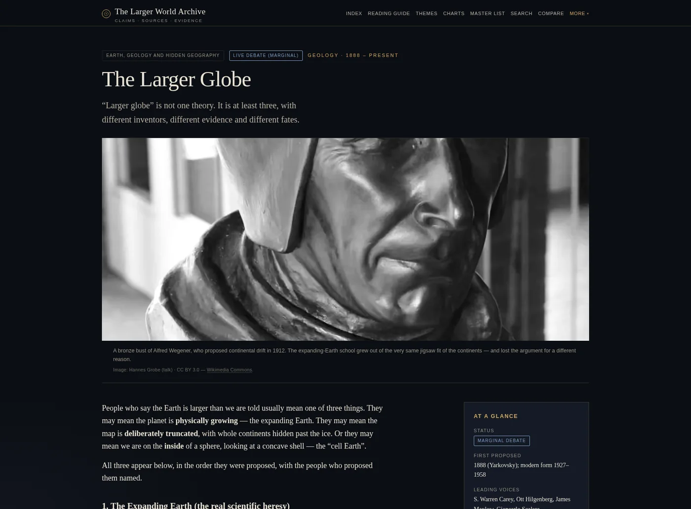
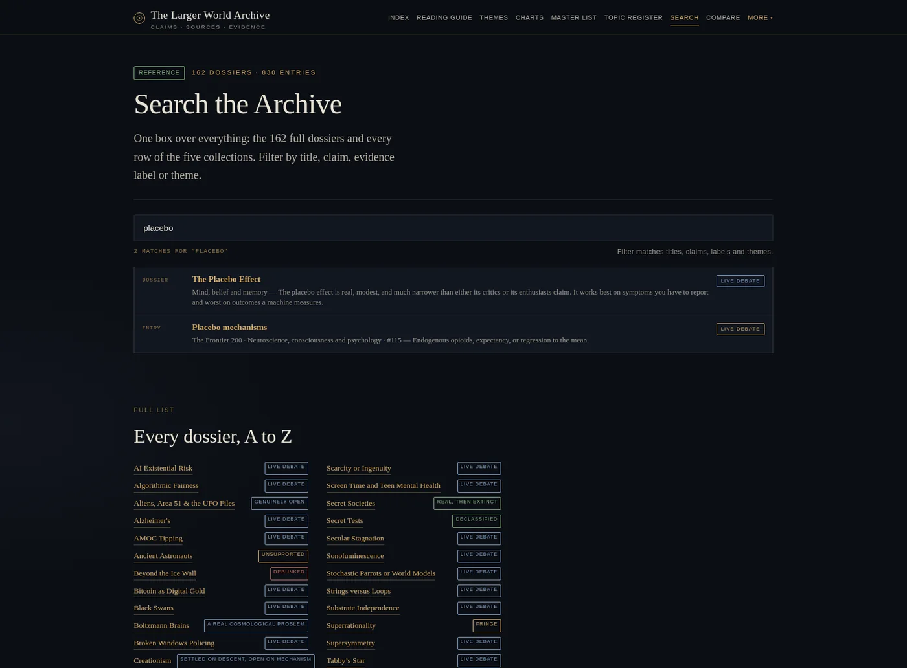
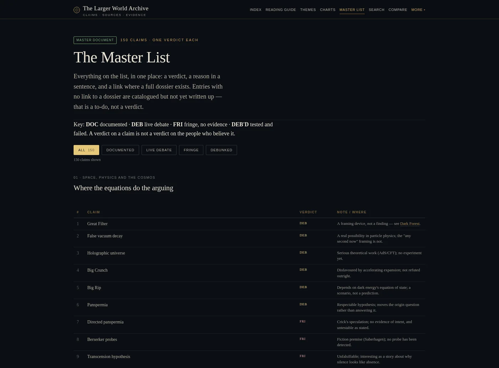
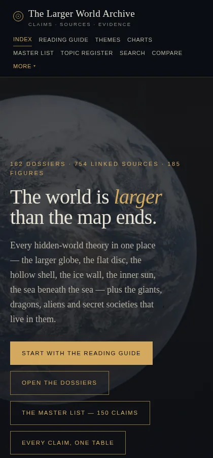
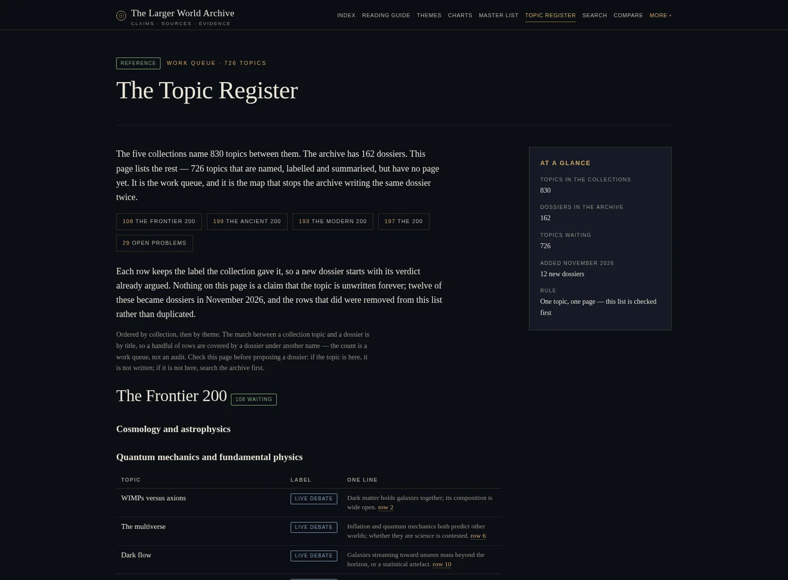
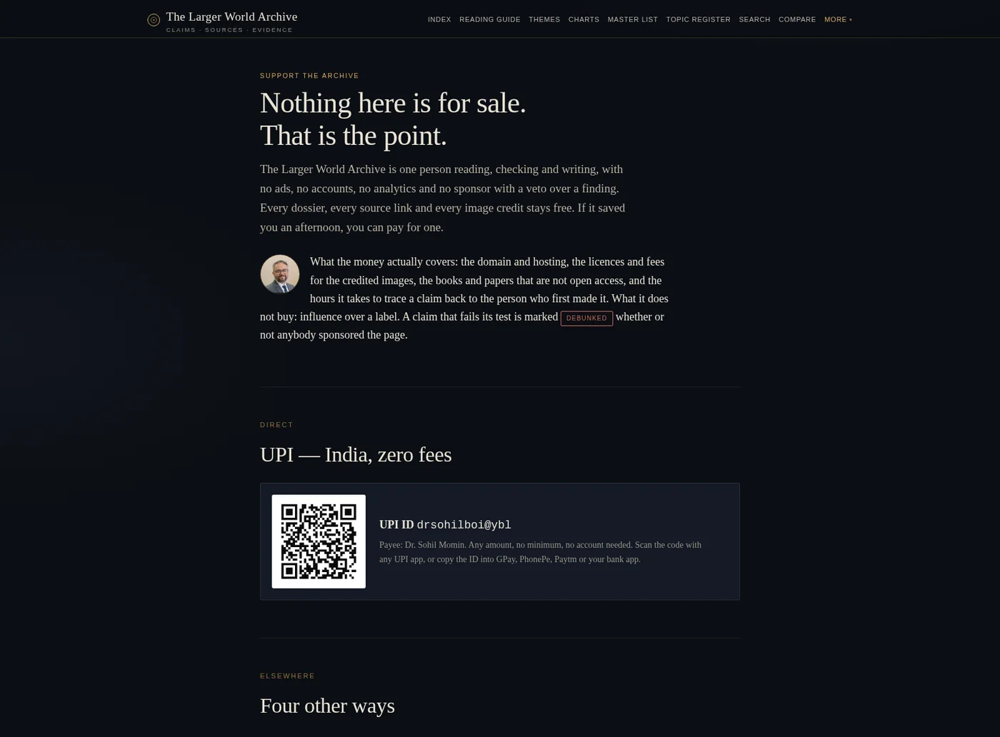

<div align="center">

# The Larger World Archive

**The world is larger than the map ends.**

A sourced reference library of hidden-world claims — the larger globe, the flat disc, the hollow shell, the ice wall, the inner sun, the sea beneath the sea — plus the giants, dragons, cryptids, aliens and secret societies that are said to live in them. Every claim is attributed to the person who made it, every source is linked, and every test is shown next to the thing it tested.

[**Read the archive**](https://drsamonline.github.io/LARGE_GLOBE/) · [Feed](https://drsamonline.github.io/LARGE_GLOBE/feed.xml) · [Reading guide](https://drsamonline.github.io/LARGE_GLOBE/reading-guide.html) · [Master list](https://drsamonline.github.io/LARGE_GLOBE/master-list.html) · [Search](https://drsamonline.github.io/LARGE_GLOBE/search.html) · [Single-volume edition](https://drsamonline.github.io/LARGE_GLOBE/print-edition.html)

[](https://drsamonline.github.io/LARGE_GLOBE/)
[](https://drsamonline.github.io/LARGE_GLOBE/master-list.html)
[](https://drsamonline.github.io/LARGE_GLOBE/sources.html)
[](#what-a-source-link-means-here)
[-2C3548?style=flat-square)](https://drsamonline.github.io/LARGE_GLOBE/credits.html)
[](#what-this-is)
[](https://drsamonline.github.io/LARGE_GLOBE/sitemap.xml)
[](#the-four-labels)
[](#how-it-is-built)
[](#privacy)
[](#running-it-locally)
[](LICENSE)
[](https://github.com/sponsors/drsamonline)
[](https://github.com/drsamonline/LARGE_GLOBE/stargazers)

</div>



---

## What this is

A hidden-world claim usually arrives in one of two shapes: a screenshot with no author, or a ninety-minute video with no citations. Both are impossible to check. This archive rebuilds each idea from the bottom up — who said it first, what they actually wrote, who repeated it, and what the measurement said afterwards.

**1010 dossiers. About 855,590 words. 4,147 linked sources. 2,985 images — 2,884 credited photographs and 101 diagrams, every one licence-checked and looked at. No account, no tracking, no paywall.**

Every dossier follows the same shape, so you always know where you are in it — breadcrumbs at the top, a citation block with APA, MLA, Chicago and BibTeX at the foot, and four neighbours from the same shelf:

| Section | What it holds |
|---|---|
| **The claim** | Stated in its strongest form, in the words of someone who actually holds it |
| **At a glance** | Status, first proposed, leading voices, the test that would settle it |
| **Origin** | Who said it, when, in what book or paper, with the page linked |
| **The best evidence** | The argument's strongest case — not a strawman of it |
| **The response** | What the field said, with the paper or the survey linked |
| **Sources** | Every link used, live, in one place at the foot of the page |

The tone is deliberately flat. The material is interesting on its own: Wegener's continental drift was ridiculed for fifty years before plate tectonics vindicated it, and the expanding-Earth school grew out of the same jigsaw fit everybody now accepts. Knowing *why* one survived and the other did not is more useful than knowing which is currently official.

## The four labels

One rule runs through every page: **a claim and its evidence are different things.** So every claim carries one of six labels, applied the same way across all 1010 dossiers — 380 as *live debate*, 250 as *documented*, 164 as *debunked*, 106 as *fringe claim*, 93 as *fiction*, 17 as *open problem*.

| Label | Means | Example |
|---|---|---|
| **Documented** | Primary documents, peer review or official records | The CIA ran MKUltra |
| **Live debate** | Argued in the literature, usually at the margins | Slow Earth expansion |
| **Fringe claim** | Widely circulated, no accepted evidence, no working mechanism | A habitable inner sun |
| **Debunked / hoax** | Tested and falsified, or admitted fabricated | The 1934 "surgeon's photograph" |

Inclusion is not endorsement, and a debunked label is not a verdict on the reader. Where a claim has been tested and failed, the test is linked beside it.

## What's in the box

- **1010 dossiers** — the larger globe, flat earth, hollow earth, ice wall, inner sun, Tartarus, giants, dragons, cryptids, Tartaria, ancient astronauts, aliens, secret societies, flood myths, urban legends, the deep web, mutants, plus frontier science (the Hubble tension, MOND, muon g−2, the firewall paradox), mind and behaviour (ego depletion, readiness potentials, screen time), economics (minimum wage, MMT, Jevons, secular stagnation) and AI (stochastic parrots, scaling laws, open weights, algorithmic fairness).
- **Five numbered collections** — [the Frontier 200](https://drsamonline.github.io/LARGE_GLOBE/frontier-index.html), [the Ancient 200](https://drsamonline.github.io/LARGE_GLOBE/ancient-index.html), [the Modern 200](https://drsamonline.github.io/LARGE_GLOBE/modern-index.html), [the 200 Sources](https://drsamonline.github.io/LARGE_GLOBE/mega-index.html) and [Open Problems](https://drsamonline.github.io/LARGE_GLOBE/open-problems.html) — 830 rows, each with a label and a one-line summary.
- **Tools that work without a server** — [search](https://drsamonline.github.io/LARGE_GLOBE/search.html) over all 980 records with deep-linkable queries, a [three-way comparison](https://drsamonline.github.io/LARGE_GLOBE/compare.html) of any three dossiers, with the selection in the URL, [charts](https://drsamonline.github.io/LARGE_GLOBE/charts.html), [themes](https://drsamonline.github.io/LARGE_GLOBE/themes.html), a [claim register](https://drsamonline.github.io/LARGE_GLOBE/claims-index.html), [the full bibliography](https://drsamonline.github.io/LARGE_GLOBE/sources.html) and a [single-volume edition](https://drsamonline.github.io/LARGE_GLOBE/print-edition.html) of the whole archive in one page.
- **Twelve dossiers added in November 2026** — cold fusion, the placebo effect, learning styles, growth mindset, the aquatic ape, Snowball Earth, the dinosaur extinction, panpsychism, the free energy principle, polyvagal theory, fast radio bursts and magnetoreception. Each carries a credited Commons photograph and an original diagram.
- **The topic register** — [755 topics](https://drsamonline.github.io/LARGE_GLOBE/topics.html) that the five collections name, label and summarise but that have no dossier yet. It is the work queue, and it is the map that stops the archive writing the same page twice.
- **A reading guide**, because a 162-dossier archive is useless if you do not know where to start.

## Screenshots

<table>
<tr>
<td width="50%"><br><sub><b>A dossier.</b> Label, claim, image credit, and the status panel that answers "how settled is this?" before you read a word. This one is new: cold fusion, with the by-product ledger drawn as a figure.</sub></td>
<td width="50%"><br><sub><b>Search.</b> One box over 980 records — dossiers and collection rows — filtered by title, claim, label or theme. Every query is a URL.</sub></td>
</tr>
<tr>
<td width="50%"><br><sub><b>The master list.</b> Every claim in one table with its label, so the whole archive can be scanned in a minute.</sub></td>
<td width="50%"><br><sub><b>On a phone.</b> No app, no hamburger maze — the same pages, reflowed.</sub></td>
</tr>
</table>



**The topic register.** Every topic the collections name that has no page of its own, with the label the collection gave it. It is the work queue and the anti-duplication map: a row here means the dossier has not been written, and a dossier that exists is not listed.



## How it is built

Plain static HTML, one stylesheet, one page of JavaScript. There is no build step, no framework, no CDN and nothing to install — `git clone` and open `index.html`. That is the whole pipeline, and it is why the archive will still open in ten years.

- **1038 pages, 25.0 MB of HTML**, generated from a single source of truth for the navigation, footer and palette, so a new dossier cannot drift from the rest.
- **No runtime dependencies.** The only script on the site is the search index on one page — inline JSON, no fetch, so it works from `file://` and offline.
- **AVIF images**, lazily loaded below the fold, 2,884 credited photographs, plus 101 vector figures drawn for this archive. Every one is credited with its licence and host on the [credits page](https://drsamonline.github.io/LARGE_GLOBE/credits.html).
- **The whole archive as a book.** A [2363-page PDF, A5](https://drsamonline.github.io/LARGE_GLOBE/assets/larger-world-archive.pdf) and a [1530 KB EPUB with a cover](https://drsamonline.github.io/LARGE_GLOBE/assets/larger-world-archive.epub), both generated from the print edition: 1013 parts, no images, sources kept, links flattened to plain text.
- **A provenance ledger.** `data/claims.json` holds every claim with its theme, its label, its at-a-glance facts and its source URLs, generated from the pages by `tools/build-ledger.py`.
- **Offline reading.** A service worker keeps the shell and every page you have opened, so a dossier read once stays readable with no connection. A page you have never opened falls back to `offline.html` rather than the browser's dinosaur.
- **An on-this-page rail** on every dossier with more than one section, sticky beside the text and highlighting the section you are reading.
- **A command palette** — `⌘K` or `Ctrl-K` anywhere on the site, searching all 1010 records without leaving the page you are reading. The index is fetched on first use, not inlined on 187 pages.
- **Keyboard reading** — `j` and `k` walk to the next and previous dossier, `/` jumps to search, `t` flips the theme, `?` opens the sheet.
- **Two themes, three type sizes.** A contrast toggle and a text-size control in the header, remembered in `localStorage`, applied before first paint so nothing flashes. The archive was dark-only for its first two years.
- **Accessible by default**: a skip link, one `<h1>` per page, landmarks, `aria-current` on the active nav item, alt text on every image and an `aria-label` on every figure, visible focus rings, and a print stylesheet that expands every citation into a readable URL.
- **Numbers that cannot drift.** `charts.html` is rebuilt from `data/claims.json` and the credits page by `tools/rebuild-charts.py`: the label distribution, the theme sizes, the licence split, the longest and thinnest source lists, and the sentence under each chart. CI fails if the page and the data disagree.
- **One source of truth for the shell.** The header and footer live once, in `index.html`; `python3 tools/rebuild-shell.py` copies them into all 188 pages and applies `aria-current` per page. CI fails if any page drifts.
- **Checked in CI.** Every push runs three checks — plus, since this pass, that every page carries the same navigation and that the palette index has not drifted from the search page: internal links and assets resolve, each page keeps its invariants (one `h1`, a canonical URL, a skip link, no empty `src`, a share card that exists, and — on every dossier — breadcrumbs, a citation block and a related strip), and no page exceeds its size budget. A weekly job re-checks every cited URL and uploads the dead ones as an artifact.
- **Deployable anywhere.** GitHub Pages serves it from the repository root; there is no `_config.yml`, no Jekyll, no Node in CI.

## Running it locally

```bash
git clone https://github.com/drsamonline/LARGE_GLOBE.git
cd LARGE_GLOBE

# either open it directly
open index.html

# or serve it, which is what Pages does
python3 -m http.server 8000     # http://localhost:8000
```

Nothing else is required. There is no `npm install`, no lockfile, no toolchain.

## Repository layout

```
.
├── index.html              the front page
├── 150 dossier pages       one claim each, same shape every time
├── *-index.html            the five numbered collections
├── master-list.html        all 157 claims, one table
├── search.html             the client-side index (1010 records)
├── search-index.json       the same index, fetched by the palette
├── data/claims.json        the provenance ledger: 1010 claims, labels, facts, sources
├── compare.html            any two dossiers side by side
├── sources.html            the bibliography, grouped by field
├── credits.html            every image, its licence and its host
├── print-edition.html      the whole archive as one printable page
├── topics.html             the 755 topics in the register
├── corrections.html        what counts as an error, and what happens next
├── how-to-read.html        the shape of a dossier, and the three ways in
├── glossary.html           40 working definitions, grouped by field
├── sw.js                   the service worker
├── offline.html            what a cold page shows with no connection
├── feed.xml                Atom feed of every dossier
├── random.html             one dossier, at random
├── support.html            how to support it, and what it does not buy
├── 404.html                served by Pages for anything off the map
├── assets/
│   ├── style.css           the only stylesheet
│   ├── larger-world-archive.pdf   the archive as a 2,343-page A5 book
│   ├── larger-world-archive.epub  the same 164 parts, reflowable, with a cover
│   ├── cover.jpg           the book cover, 1600×2400
│   ├── og/                 162 per-dossier share cards
│   ├── cite.js             the copy-to-clipboard for the citation block
│   ├── prefs.js            the light-theme and type-size controls
│   ├── keys.js             keyboard reading, shortcut sheet, rail highlighting
│   ├── palette.js          the ⌘K palette
│   ├── img/s/              480px WebP hero variants for phones
│   └── img/                166 AVIF photographs and 18 SVG figures
├── docs/screenshots/       the images in this README
├── sitemap.xml             all 185 indexable URLs, each with its git date
├── tools/                  the checks CI runs, the shell generator, the chart and ledger builders
├── .github/workflows/      structure, size budget, weekly link check
└── robots.txt
```

## What a source link means here

4,147 citations across 267 domains — Wikipedia and Wikimedia Commons for orientation and images, then `doi.org`, `arxiv.org`, `nature.com`, `science.nasa.gov`, `plato.stanford.edu`, `ncse.ngo` and the primary texts themselves. A link is placed next to the sentence it supports, not gathered in a heap at the bottom, so you can check a specific claim in a specific paragraph.

Links rot. If one is dead, [open an issue](https://github.com/drsamonline/LARGE_GLOBE/issues) with the page and the link; it gets replaced or annotated, not quietly removed.

## Privacy

No accounts, no cookies, no analytics, no fonts or scripts from a third-party host, no email capture. The site is static files on GitHub Pages, so GitHub sees what any web server sees. Search runs entirely in your browser against an inline index — your queries never leave the page, and are only ever in the URL because you can share them.

## Support


Free, unpaywalled, untracked, and staying that way. If the archive saved you an afternoon, you can pay for one:

| | |
|---|---|
| UPI (India) | `drsohilboi@ybl` — payee Dr. Sohil Momin, open amount, or scan [the QR](assets/upi-qr.svg) |
| GitHub Sponsors | [github.com/sponsors/drsamonline](https://github.com/sponsors/drsamonline) |
| Ko-fi | [ko-fi.com/matneo](https://ko-fi.com/matneo) |
| PayPal | [paypal.me/drsohilmomin](https://paypal.me/drsohilmomin?locale.x=en_GB&country.x=IN) |
| My books | [Amazon author store](https://www.amazon.com/stores/author/B08ZT331LY/allbooks?ccs_id=aed72b9f-71d9-43dc-adee-e9368a317acc) |
| Everything else | [drsamonline.github.io](https://drsamonline.github.io/) |
| Email | [sohilmomin2000@gmail.com](mailto:sohilmomin2000@gmail.com) |

Nothing is gated behind it, no tier exists, and a sponsor gets no say over a label. A claim that fails its test is marked **debunked** whether or not anybody paid for the page.

<div align="center">

[](https://github.com/sponsors/drsamonline)
[](https://ko-fi.com/matneo)
[](https://paypal.me/drsohilmomin?locale.x=en_GB&country.x=IN)
[](https://www.amazon.com/stores/author/B08ZT331LY/allbooks)

<sub>Built and written by [Dr. Sohil Momin](https://github.com/drsamonline) · UPI QR for direct support: [assets/upi-qr.svg](assets/upi-qr.svg)</sub>

</div>

See [CHANGELOG.md](CHANGELOG.md) for every change, generated from the commit history.

## Checking it

One command runs every consistency check:

```bash
python3 tools/check-all.py          # all checks
python3 tools/check-all.py --fast   # skip the arithmetic sweep
```

| Check | What it catches |
|---|---|
| `check-structure.py` | broken internal links, dead anchors, missing skip links, heading and canonical errors |
| `check-size.py` | a page over its size budget |
| `check-images.py` | figures pointing at missing files, orphan images, blank frames, credits out of step, wrong counts, images without dimensions, a stated PDF page count that disagrees with the file |
| `rebuild-shell.py --check` | a page whose header or footer has drifted from the canonical shell |
| `rebuild-charts.py --check` | a chart that no longer matches the ledger |
| `build-sitemap.py --check` | a page missing from the sitemap |
| `build-feed.py --check` | a stale feed |
| `stamp-css.py --check` | a page carrying an old stylesheet hash |
| `update-readme.py --check` | a number in this README that no longer matches the repository |
| `check-epub.py` | an EPUB whose container, manifest, spine or XHTML has broken, a UUID that is not a UUID, or a build date older than the content |
| `check-math.py` | an arithmetic claim in a mathematics dossier that no longer holds |

How the archive is checked, what the checks have caught, and what is *not* checked is in [docs/AUDIT.md](docs/AUDIT.md).

The generators — `build-credits.py`, `build-changelog.py`, `build-paths.py`, `build-sitemap.py`, `build-feed.py`, `update-readme.py` — rebuild their page or file from the repository, so no figure in this project is typed twice.

## Licence, privacy and disclaimer

The text and diagrams are CC BY-NC 4.0 ([LICENSE](LICENSE)). What is inside that the
archive did not make — 2,827 photographs from Wikimedia Commons, and the tools used to
build the site — is recorded in [NOTICE.md](NOTICE.md). What the site does with your data
is in [PRIVACY.md](PRIVACY.md), and what it is not qualified to tell you is in
[DISCLAIMER.md](DISCLAIMER.md).

## Licence

**The writing** — every dossier, index, chart caption and page in this repository — is © Dr. Sohil Momin, released under [CC BY-NC 4.0](LICENSE): read it, quote it, teach from it, mirror it, translate it, with attribution and not for commercial resale.

**The images** are not mine to license. Each is credited on the [credits page](https://drsamonline.github.io/LARGE_GLOBE/credits.html) with its host and its own terms — mostly Wikimedia Commons, public domain, CC BY or CC BY-SA. Reuse an image only under the licence named beside it, not under the licence above.

**The claims belong to the people who made them**, and are quoted for study. Attribution is the point of the archive; if a quotation is misattributed or a credit is wrong, that is a bug, and [reporting it](https://github.com/drsamonline/LARGE_GLOBE/issues) fixes it.

## Credits

Built with nothing but HTML and CSS, and a great deal of reading. Every diagram in the archive is drawn for it — the SVGs in `assets/img/fig-*.svg` are original work, released under the same licence as the writing, so they can be reused with attribution. Structure, palette and the print stylesheet follow the house style of the [drsamonline](https://drsamonline.github.io/) sites; the source list leans on Wikimedia Commons, the Internet Archive, NASA, the Royal Society, Nature, arXiv and the Stanford Encyclopedia of Philosophy. Full attribution is in [credits.html](https://drsamonline.github.io/LARGE_GLOBE/credits.html) and [sources.html](https://drsamonline.github.io/LARGE_GLOBE/sources.html).
